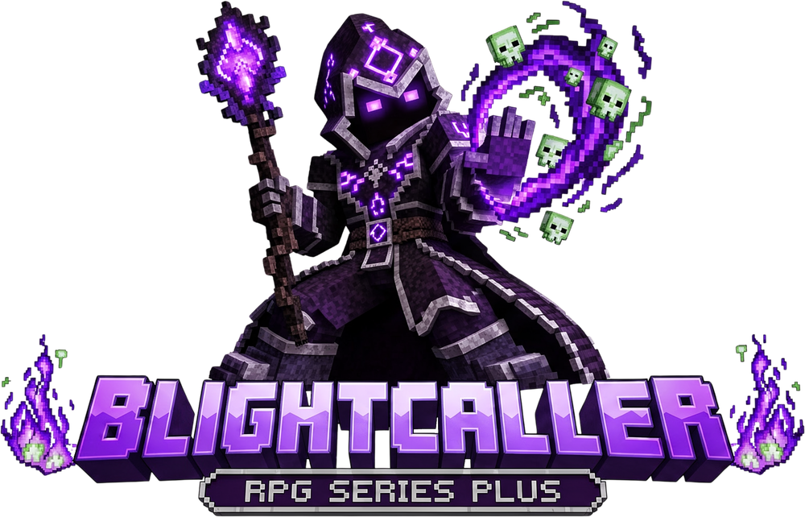
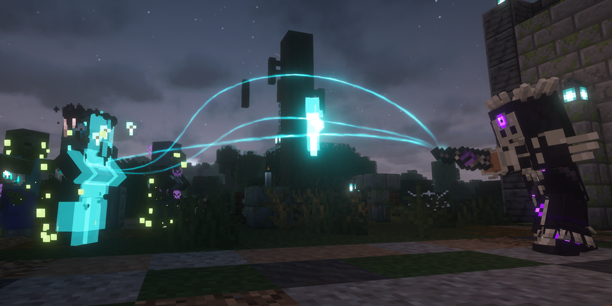

  

# Blightcaller (RPG Series Plus)

Blightcaller (RPG Series Plus) is a curse class of the soul school for Spell Engine and the RPG Series: eight spells that deal damage over time, weaken enemies and let curses move on from enemy to enemy, with its own robes from tier 1 to 4, wands, grimoires and a spell book.

**Beta:** 0.1.0 is the first public version. Numbers can still change, and I'm glad about bug reports and balance feedback on the [issue tracker](https://github.com/Drehverschluss/Blightcaller/issues).

Blightcaller is a standalone class mod for Spell Engine and the RPG Series by Daedelus, not an addon for Wizards, and it does not need Wizards. It is not made by or affiliated with the original author.

- Minecraft 1.21.1 / NeoForge
- Install it on both client and server.

  

## Required

- [Spell Engine](https://www.curseforge.com/minecraft/mc-mods/spell-engine)
- [Spell Power Attributes](https://www.curseforge.com/minecraft/mc-mods/spell-power)
- [Runes](https://www.curseforge.com/minecraft/mc-mods/rune-crafting)
- [Armor Model API](https://www.curseforge.com/minecraft/mc-mods/armor-model-api)

## Recommended

- [RunelessRPG](https://www.curseforge.com/minecraft/mc-mods/runelessrpg) – cast with mana instead of Soul Runes
- [Better Combat](https://www.curseforge.com/minecraft/mc-mods/better-combat-by-daedelus) – proper attacks with the wands

## Optional

- [Skill Tree (RPG Series)](https://www.curseforge.com/minecraft/mc-mods/skill-tree) – the Blightcaller branch in the Class Skills tab and Hex Bolt and Blight Burst nodes in the Weapon Skills tab
- [Curios API](https://www.curseforge.com/minecraft/mc-mods/curios) – rings, amulets and relics
- [Jade](https://www.curseforge.com/minecraft/mc-mods/jade) – curse level and every curse with its remaining time when you look at a mob
- [Health Bars](https://www.curseforge.com/minecraft/mc-mods/health-bars) – a row of curses with their seconds at the health bar box
- [Better End](https://www.curseforge.com/minecraft/mc-mods/betterend-neoforge) – the Dragonbone Blight Wand and Grimoire of tier 4
- [Wizards (RPG Series)](https://www.curseforge.com/minecraft/mc-mods/wizards) – Blightcaller offers at the Wizard Merchant

## Links

- Wiki: https://github.com/Drehverschluss/Blightcaller/wiki
- Issues: https://github.com/Drehverschluss/Blightcaller/issues
- CurseForge: https://www.curseforge.com/minecraft/mc-mods/blightcaller-rpg-series-plus

## License

MIT, see [LICENSE](LICENSE). Credits for dependencies and integrations are in [CREDITS.md](CREDITS.md).
